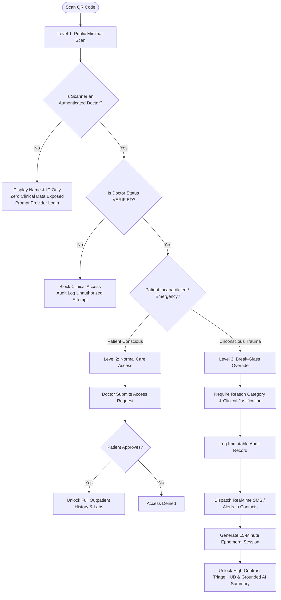
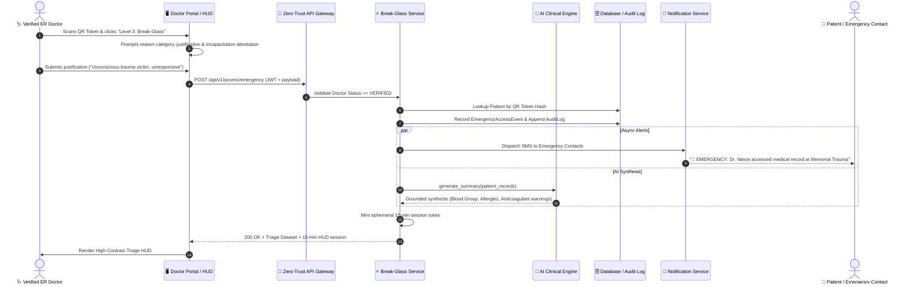
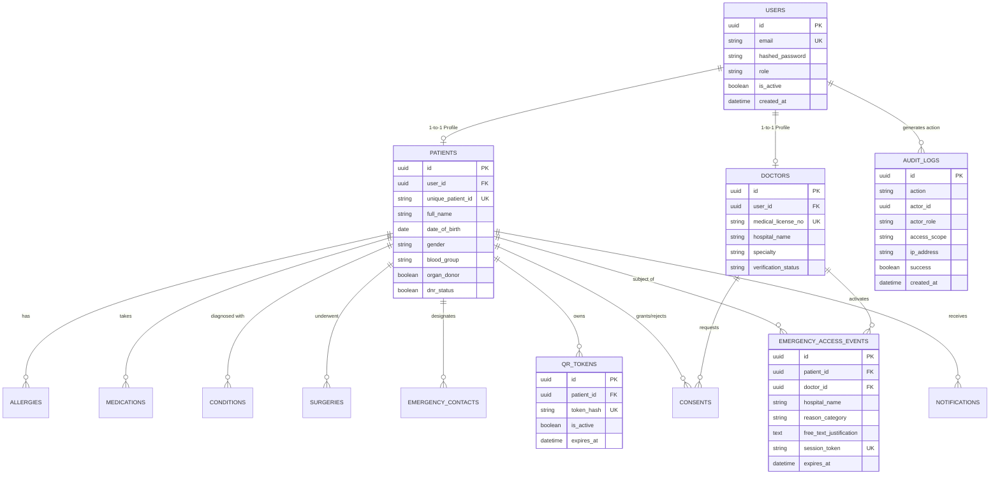

# Full Architecture & Codebase Technical Specification
## AI-Powered Secure Emergency Medical History Access System (EMQ-HS)

> **Zero-Trust Healthcare Triage, Break-Glass Protocol & Grounded AI Synthesis**  
> *Core Principle: Fast access to critical emergency medical information without giving unrestricted access to the patient's complete medical history.*

---

## Table of Contents
1. [Executive Summary & Problem Statement](#1-executive-summary--problem-statement)
2. [End-to-End System Architecture](#2-end-to-end-system-architecture)
   - [Architectural Topology](#architectural-topology)
   - [Three-Level Access Continuum](#three-level-access-continuum)
   - [Break-Glass Emergency Sequence Flow](#break-glass-emergency-sequence-flow)
3. [Complete Codebase File Catalog](#3-complete-codebase-file-catalog)
4. [Data Models & Entity Relationships](#4-data-models--entity-relationships)
   - [Entity-Relationship Diagram](#entity-relationship-diagram)
   - [Detailed Table Schemas](#detailed-table-schemas)
5. [API Endpoint Reference (REST & FHIR)](#5-api-endpoint-reference-rest--fhir)
6. [Security, Cryptography & Compliance](#6-security-cryptography--compliance)
   - [Role-Based Access Control (RBAC)](#role-based-access-control-rbac)
   - [Security Headers & Rate Limiting](#security-headers--rate-limiting)
   - [Break-Glass Non-Repudiation & Audit Trail](#break-glass-non-repudiation--audit-trail)
7. [AI Clinical Synthesis Engine](#7-ai-clinical-synthesis-engine)
8. [Frontend Architecture & User Interfaces](#8-frontend-architecture--user-interfaces)
9. [Deployment, Configuration & Testing](#9-deployment-configuration--testing)
10. [Academic Implementation Matrix](#10-academic-implementation-matrix)

---

## 1. Executive Summary & Problem Statement

### The Healthcare Emergency Dilemma
During acute trauma, cardiac arrest, or motor vehicle collisions, emergency first responders and ER trauma teams need immediate clinical data (blood group, severe allergies, active anticoagulants, resuscitation directives). However, the patient is often unconscious or incapacitated.

Conventional QR or digital health approaches present severe security and privacy hazards:
- **Plaintext QR Cards**: Anyone who scans the card (bystander, employer, malicious third party) sees full clinical history, psychiatric records, infectious disease status, and diagnoses.
- **Unrestricted Public Web Redirection**: Public QR codes pointing to open URLs leak Protected Health Information (PHI) to scrapers and unauthorized individuals.
- **Total Lockdown**: Requiring complex multi-factor authentication or conscious patient approval in the field leads to fatal treatment delays.

### The EMQ-HS Solution
The **Emergency Medical QR Health System (EMQ-HS)** eliminates this hazard through a **Zero-Trust, Three-Level Compartmentalized Architecture**:
1. **Opaque Physical QR Tokens**: The card contains only an opaque cryptographic identifier (`demo-emergency-token-9812`), never medical data.
2. **Public Security Barrier (Level 1)**: Any unauthenticated scan displays only patient verification information and demands medical credentials.
3. **Consensual Normal Care (Level 2)**: Verified physicians can review outpatient history only when the conscious patient approves their access request.
4. **Break-Glass Emergency Triage (Level 3)**: In life-or-death crises, a verified ER physician can initiate an emergency override. The system demands a mandatory clinical reason, logs an immutable audit event, triggers real-time proxy alerts, and unlocks an ephemeral 15-minute high-contrast Triage HUD with a **hallucination-free AI clinical summary**.

---

## 2. End-to-End System Architecture

### Architectural Topology

```
┌────────────────────────────────────────────────────────────────────────┐
│                        1. CLIENT TOUCHPOINTS                           │
│  [📱 Patient Portal]    [🩺 Doctor Triage HUD]    [🪪 Physical QR Card] │
└───────────────────────────────────┬────────────────────────────────────┘
                                    │ HTTPS / TLS 1.3
                                    ▼
┌────────────────────────────────────────────────────────────────────────┐
│                        2. ZERO-TRUST GATEWAY                           │
│     [🛡️ Security Headers]  [🚪 Rate Limiter]  [🔑 JWT / RBAC Guard]     │
└───────────────────────────────────┬────────────────────────────────────┘
                                    │
                                    ▼
┌────────────────────────────────────────────────────────────────────────┐
│                     3. CORE BACKEND SERVICES (FastAPI)                 │
│  ┌──────────────────────┐  ┌─────────────────────┐  ┌────────────────┐ │
│  │ Break-Glass Service  │  │  Patient Records    │  │ QR Resolution  │ │
│  └──────────────────────┘  └─────────────────────┘  └────────────────┘ │
│  ┌──────────────────────┐  ┌─────────────────────┐  ┌────────────────┐ │
│  │ AI Clinical Engine   │  │  Audit & Telemetry  │  │ Notifications  │ │
│  └──────────────────────┘  └─────────────────────┘  └────────────────┘ │
└───────────────────────────────────┬────────────────────────────────────┘
                                    │
                                    ▼
┌────────────────────────────────────────────────────────────────────────┐
│                      4. DATA & PERSISTENCE TIER                        │
│   [🗄️ PostgreSQL / SQLite]   [🔐 Field Encryption]  [📋 Append-Only Log]│
└────────────────────────────────────────────────────────────────────────┘
```

### Three-Level Access Continuum



### Break-Glass Emergency Sequence Flow



---

## 3. Complete Codebase File Catalog

```
secure-emergency-medical-system/
│
├── run_dev.py                   # Unified single-command launcher with auto-seeding
├── docker-compose.yml           # Production Docker multi-container deployment (Postgres + Backend)
├── README.md                    # Project introduction and quickstart overview
├── run.txt                      # Execution command reference
│
├── backend/                     # Complete Python / FastAPI Core Backend
│   ├── Dockerfile               # Container build recipe for production
│   ├── requirements.txt         # Python library dependencies
│   ├── check_views.py           # Verification script for database views/state
│   ├── medical_system.db        # Pre-seeded SQLite development database
│   │
│   ├── app/
│   │   ├── main.py              # Application entrypoint, middleware, routers, static UI mount
│   │   │
│   │   ├── core/
│   │   │   ├── config.py        # Pydantic BaseSettings, environment variables & tokens
│   │   │   ├── rbac.py          # Enums (UserRole, AccessLevel, DoctorVerificationStatus, AuditAction)
│   │   │   └── security.py      # Password hashing (bcrypt), JWT generation & verification
│   │   │
│   │   ├── database/
│   │   │   ├── base.py          # Declarative Base for SQLAlchemy ORM
│   │   │   ├── session.py       # DB engine, SessionLocal, and get_db dependency
│   │   │   └── seeder.py        # Automated mock data seeder (patients, doctors, conditions, meds)
│   │   │
│   │   ├── middleware/
│   │   │   ├── rate_limiter.py  # In-memory sliding-window IP rate limiting
│   │   │   └── security_headers.py # Security headers (CSP, HSTS, X-Frame-Options, nosniff)
│   │   │
│   │   ├── models/              # SQLAlchemy Database Entities
│   │   │   ├── user.py          # Core User account model (email, password hash, role)
│   │   │   ├── patient.py       # Patient profile model (blood group, organ donor, DNR)
│   │   │   ├── doctor.py        # Doctor profile model (license, hospital, verification status)
│   │   │   ├── medical.py       # Allergy, Medication, MedicalCondition, Surgery models
│   │   │   ├── access.py        # QRToken, EmergencyAccessEvent, DoctorConsent models
│   │   │   ├── audit.py         # AuditLog compliance table
│   │   │   └── notification.py  # Notification and SMS alert records
│   │   │
│   │   ├── schemas/             # Pydantic Request/Response Validation DTOs
│   │   │   ├── auth.py          # User registration, login, token schemas
│   │   │   ├── patient.py       # Patient input/output schemas
│   │   │   ├── doctor.py        # Doctor registration and verification schemas
│   │   │   ├── medical.py       # Allergies, medications, condition schemas
│   │   │   ├── access.py        # Break-Glass request/response schemas
│   │   │   ├── qr.py            # QR resolution and card metadata schemas
│   │   │   ├── ai.py            # AI summary request/response schemas
│   │   │   └── audit.py         # Audit log query schemas
│   │   │
│   │   ├── services/            # Core Domain Business Logic
│   │   │   ├── qr_service.py    # Opaque token generation, QR code image generation
│   │   │   ├── break_glass_service.py # Level-3 emergency protocol, 15-min session controller
│   │   │   ├── ai_service.py    # Grounded rule-based clinical engine + OpenAI fallback
│   │   │   ├── audit_service.py # Immutable append-only audit logger
│   │   │   ├── notification_service.py # Emergency SMS & in-app alert dispatcher
│   │   │   └── storage_service.py # Document storage abstraction (local disk / S3)
│   │   │
│   │   ├── api/v1/              # API Route Controllers
│   │   │   ├── auth.py          # /auth (register, login, refresh, me)
│   │   │   ├── patients.py      # /patients (profiles, records, contacts, audit view)
│   │   │   ├── doctors.py       # /doctors (doctor profile, status check)
│   │   │   ├── qr.py            # /qr (generate, resolve public, doctor-scan)
│   │   │   ├── access.py        # /access (emergency break-glass, normal consent flow)
│   │   │   ├── ai.py            # /ai (emergency summary generator)
│   │   │   ├── admin.py         # /admin (doctor verification, audit review, stats)
│   │   │   ├── fhir.py          # /fhir (HL7 FHIR R4 interoperability bundle)
│   │   │   └── metrics.py       # /metrics (Prometheus-style telemetry)
│   │   │
│   │   └── static/
│   │       └── index.html       # Built single-file complete Web Application UI
│   │
│   └── tests/                   # Automated Pytest Test Suite
│       ├── conftest.py          # Test database fixtures & client setup
│       ├── test_auth.py         # Tests for authentication & token verification
│       ├── test_qr_and_levels.py # Tests for Level 1/2/3 QR isolation
│       ├── test_break_glass.py  # Tests for mandatory justification & session timer
│       ├── test_consent_workflow.py # Tests for Level-2 doctor consent request/approval
│       ├── test_ai_summarizer.py # Tests for zero-hallucination grounded summary
│       └── test_audit.py        # Tests for tamper-evident compliance logging
│
├── frontend/                    # Vite + React + TypeScript Source Project
│   ├── index.html               # Frontend HTML root
│   ├── package.json             # NPM dependencies (React 18, Lucide, Tailwind)
│   ├── tsconfig.json            # TypeScript configuration
│   ├── vite.config.ts           # Vite build config & proxy to http://localhost:8000
│   ├── tailwind.config.js       # Tailwind CSS styling framework
│   └── src/
│       ├── main.tsx             # React DOM mounting
│       ├── index.css            # Global CSS styles
│       └── App.tsx              # Comprehensive SPA component (Landing, Patient, Doctor, Admin, HUD)
│
└── docs/                        # Technical Documentation Folder
    ├── FULL_ARCHITECTURE_AND_CODEBASE.md # (This document) Master reference
    ├── architecture.md          # System architecture specification
    ├── api.md                   # REST API endpoint inventory
    ├── database.md              # Entity relational models & indexes
    ├── security.md              # Security controls & academic disclosure
    └── demo.md                  # Step-by-step presentation demonstration guide
```

---

## 4. Data Models & Entity Relationships

### Entity-Relationship Diagram



### Detailed Table Schemas

#### 1. `users`
*Core account table for authentication and RBAC.*
- `id` (UUID, Primary Key)
- `email` (String, Unique, Indexed)
- `hashed_password` (String, salted bcrypt hash)
- `role` (Enum: `PATIENT`, `DOCTOR`, `SYSTEM_ADMIN`)
- `is_active` (Boolean, default `True`)
- `created_at` (DateTime, UTC)

#### 2. `patients`
*Patient demographic and baseline triage profile.*
- `id` (UUID, Primary Key)
- `user_id` (UUID, Foreign Key -> `users.id`)
- `unique_patient_id` (String, Unique, format: `PAT-2026-XXXX`)
- `full_name` (String)
- `date_of_birth` (Date)
- `gender` (String)
- `blood_group` (String: `O+`, `O-`, `A+`, `A-`, `B+`, `B-`, `AB+`, `AB-`)
- `organ_donor` (Boolean, default `False`)
- `dnr_status` (Boolean, Do Not Resuscitate order, default `False`)

#### 3. `doctors`
*Physician credentialing and hospital affiliation table.*
- `id` (UUID, Primary Key)
- `user_id` (UUID, Foreign Key -> `users.id`)
- `medical_license_no` (String, Unique, e.g. `MD-98214-ER`)
- `hospital_name` (String)
- `specialty` (String, e.g. `Emergency Medicine`)
- `verification_status` (Enum: `PENDING`, `VERIFIED`, `REJECTED`, `SUSPENDED`)
- `verified_at` (DateTime, Nullable)

#### 4. `allergies`, `medications`, `conditions`, `surgeries`
*Compartmentalized clinical tables.*
- **`allergies`**: `allergen`, `severity` (`MILD`, `MODERATE`, `SEVERE_ANAPHYLAXIS`), `reaction`, `is_critical_flag`
- **`medications`**: `medicine_name`, `dosage`, `frequency`, `prescribed_for`, `is_anticoagulant_flag`
- **`conditions`**: `condition_name`, `icd10_code`, `status` (`ACTIVE`, `MANAGED`, `RESOLVED`)
- **`surgeries`**: `procedure_name`, `surgery_date`, `hospital_facility`

#### 5. `emergency_access_events`
*Non-repudiated Break-Glass registry.*
- `id` (UUID, Primary Key)
- `patient_id` (UUID, Foreign Key -> `patients.id`)
- `doctor_id` (UUID, Foreign Key -> `doctors.id`)
- `hospital_name` (String)
- `reason_category` (String: `Unconscious Trauma`, `Cardiac Arrest`, `Severe Stroke`, etc.)
- `free_text_justification` (Text, minimum required length enforced)
- `patient_consent_incapacitated` (Boolean, mandatory attestation)
- `session_token` (String, Unique, format: `bg_<uuid>`, valid for 15 minutes)
- `expires_at` (DateTime, UTC)

#### 6. `audit_logs`
*Immutable compliance audit trail.*
- `id` (UUID, Primary Key)
- `action` (String: `LOGIN`, `LEVEL_1_SCAN`, `BREAK_GLASS_ACTIVATE`, `CONSENT_GRANT`, etc.)
- `actor_id` (UUID, Nullable)
- `actor_email` (String, Nullable)
- `actor_role` (String)
- `target_patient_id` (UUID, Nullable)
- `access_scope` (String: `LEVEL_1_MINIMAL`, `LEVEL_2_NORMAL`, `LEVEL_3_BREAK_GLASS`)
- `ip_address` (String)
- `user_agent` (String, Nullable)
- `success` (Boolean)
- `created_at` (DateTime, UTC, Indexed)

---

## 5. API Endpoint Reference (REST & FHIR)

All API endpoints are prefixed with `/api/v1`. Full OpenAPI interactive documentation is generated at `http://localhost:8000/docs`.

### Authentication (`/auth`)
| Method | Endpoint | Access | Purpose |
| :--- | :--- | :--- | :--- |
| `POST` | `/auth/register/patient` | Public | Self-registration, generates MRN and first QR token |
| `POST` | `/auth/register/doctor` | Public | Doctor registration with initial `PENDING` status |
| `POST` | `/auth/login` | Public | Returns JWT `access_token` and `refresh_token` |
| `POST` | `/auth/refresh` | Public | Issues new access token from refresh token |
| `GET` | `/auth/me` | Authenticated | Returns current authenticated user and role profile |

### QR Token Management & Scanning (`/qr`)
| Method | Endpoint | Access | Purpose |
| :--- | :--- | :--- | :--- |
| `GET` | `/qr/resolve/{token}` | **Public** | **Level 1 Public Minimal Scan**. Returns patient ID and notice requiring physician login. **Zero clinical data.** |
| `POST` | `/qr/doctor-scan/{token}`| Doctor | Verified physician scans token; verifies doctor status and returns patient identification and access choices |
| `POST` | `/qr/generate` | Patient | Generates a new opaque QR token or rotates existing token |
| `GET` | `/qr/card` | Patient | Generates high-res dual-sided emergency card with base64 QR |

### Access Control & Break-Glass (`/access`)
| Method | Endpoint | Access | Purpose |
| :--- | :--- | :--- | :--- |
| `POST` | `/access/emergency` | **Doctor (Verified)** | **Level 3 Break-Glass Protocol**. Demands justification; logs audit; dispatches SMS; returns filtered Triage HUD & 15-min session token |
| `POST` | `/access/request` | Doctor (Verified) | Requests normal Level 2 outpatient clinical consent |
| `GET` | `/access/normal/{id}` | Doctor (Verified) | **Level 2 Normal Care Access**. Returns complete records only if active consent exists |
| `GET` | `/access/requests/pending`| Patient | Lists pending doctor consent requests |
| `POST` | `/access/requests/{id}/review`| Patient | Approves or rejects doctor access request |
| `POST` | `/access/consents/revoke/{id}`| Patient | Immediately revokes an active consent grant |

### Patient Portal (`/patients`)
| Method | Endpoint | Access | Purpose |
| :--- | :--- | :--- | :--- |
| `GET` | `/patients/me` | Patient | Fetches complete personal medical profile |
| `PUT` | `/patients/me` | Patient | Updates blood group, organ donor, DNR directives |
| `POST` | `/patients/allergies` | Patient | Adds an allergy record |
| `POST` | `/patients/medications` | Patient | Adds an active medication |
| `POST` | `/patients/emergency-contacts`| Patient | Adds or updates emergency proxy contacts |
| `GET` | `/patients/access-history` | Patient | Displays immutable log of every doctor access |
| `GET` | `/patients/notifications` | Patient | Returns real-time alerts and Break-Glass notifications |

### Admin & Credentialing (`/admin`)
| Method | Endpoint | Access | Purpose |
| :--- | :--- | :--- | :--- |
| `GET` | `/admin/doctors` | Admin | Lists all registered physicians and status |
| `POST` | `/admin/doctors/verify` | Admin | Promotes/updates doctor status (`VERIFIED`/`REJECTED`) |
| `GET` | `/admin/stats` | Admin | System dashboard metrics and operational counters |
| `GET` | `/admin/audit-logs` | Admin | Complete system-wide compliance audit log |
| `GET` | `/admin/emergency-events`| Admin | Real-time active Break-Glass incident monitor |

### AI Clinical Summarizer & Interoperability (`/ai`, `/fhir`)
| Method | Endpoint | Access | Purpose |
| :--- | :--- | :--- | :--- |
| `POST` | `/ai/emergency-summary` | Doctor/Internal | Generates grounded, hallucination-free clinical synthesis |
| `GET` | `/fhir/Patient/{id}` | Doctor | Exports patient record in standard HL7 FHIR R4 JSON format |
| `GET` | `/metrics` | Public/Monitoring | Prometheus telemetry counters for system observability |
| `GET` | `/health` | Public | Readiness and liveness health probe |

---

## 6. Security, Cryptography & Compliance

### Role-Based Access Control (RBAC)

The system enforces strict multi-layered authorization:
```
           ┌────────────────────────────────────────┐
           │              USER ROLES                │
           └──────────────────┬─────────────────────┘
                              │
         ┌────────────────────┼─────────────────────┐
         ▼                    ▼                     ▼
   [ 👤 PATIENT ]       [ 🩺 DOCTOR ]         [ 🔑 ADMIN ]
   - Own profile only   - Requires VERIFIED   - Verification console
   - Rotate QR token    - Level 2 with Consent- System audit logs
   - Review audit log   - Level 3 Break-Glass - Telemetry & metrics
   - Manage proxies     - Read FHIR bundles   - Revoke rogue accounts
```

- **Doctor Verification Gate**: A registered doctor starts with `PENDING` status. Even with valid credentials, `PENDING` or `SUSPENDED` doctors are cryptographically prevented from executing Break-Glass access or viewing patient clinical data.

### Security Headers & Rate Limiting

The application embeds custom enterprise security middleware:
1. **Security Headers (`SecurityHeadersMiddleware`)**:
   - `Content-Security-Policy`: Restricts resource injection.
   - `Strict-Transport-Security`: Enforces HTTPS (HSTS).
   - `X-Content-Type-Options: nosniff`: Prevents MIME-confusion attacks.
   - `X-Frame-Options: DENY`: Prevents clickjacking.
   - `X-XSS-Protection: 1; mode=block`: Legacy browser XSS filter.
2. **Rate Limiting (`RateLimiterMiddleware`)**:
   - Implements an in-memory sliding-window rate limiter (60 requests per minute per IP).
   - Prevents brute-force dictionary attacks against QR lookup and authentication endpoints.

### Break-Glass Non-Repudiation & Audit Trail

The Break-Glass override cannot be triggered anonymously or arbitrarily:
1. **Mandatory Non-Repudiation**: The attending physician’s unique ID, medical license, hospital name, IP address, user-agent, reason category, and detailed clinical justification are recorded.
2. **Incapacitation Attestation**: The physician must explicitly certify that the patient is unconscious or in life-threatening trauma unable to provide consent.
3. **Automated Proxy Alerting**: Upon activation, high-priority simulated SMS notifications are immediately dispatched to the patient and their emergency proxies.
4. **15-Minute Ephemeral Session**: The returned `session_token` automatically expires after 15 minutes, ensuring emergency access is strictly bounded.
5. **Immutable Compliance Audit**: Every access request (both successful and blocked) is committed to an append-only `audit_logs` table for medico-legal accountability.

---

## 7. AI Clinical Synthesis Engine

In life-or-death emergency triage, **hallucinations can be fatal**. An AI model that invents an allergy or omits an anticoagulant risks killing the patient.

EMQ-HS employs a **Grounded, Zero-Hallucination Architecture**:

```
 ┌────────────────────────────────────────────────────────┐
 │           PATIENT CLINICAL DATA (DATABASE)             │
 │  Blood Group | Allergies | Medications | Conditions    │
 └───────────────────────────┬────────────────────────────┘
                             │
                             ▼
 ┌────────────────────────────────────────────────────────┐
 │            DETERMINISTIC CLINICAL RULE ENGINE          │
 │  • Filters only high-severity / anaphylactic allergies │
 │  • Identifies bleeding risks (Warfarin, Heparin)       │
 │  • Identifies metabolic warnings (Insulin)             │
 │  • Formats resuscitation directives (DNR status)       │
 └───────────────────────────┬────────────────────────────┘
                             │
                             ▼
 ┌────────────────────────────────────────────────────────┐
 │            100% GROUNDED EMERGENCY SYNTHESIS           │
 │  • Explicit citations to database record IDs           │
 │  • Zero speculative claims                             │
 │  • Fully operational offline without external API keys │
 └────────────────────────────────────────────────────────┘
```

### Traceability Guarantee
Each clinical finding generated by `RuleBasedEmergencySummarizer` (in [ai_service.py](file:///c:/Users/Aditya/Downloads/CLG_Project/Vaishu/secure-emergency-medical-system/backend/app/services/ai_service.py)) includes source traceability citations:
```json
{
  "summary_text": "EMERGENCY CLINICAL SYNTHESIS FOR DEMO PATIENT:\n• Blood Group: O+.\n• Allergies: Penicillin (Severe Anaphylaxis).\n• Current Medications: Warfarin (5mg, Once daily evening).\n• Active Conditions: Atrial Fibrillation [ACTIVE].",
  "blood_group": "O+",
  "critical_allergies": ["Penicillin (Severe Anaphylaxis) - Reaction: Severe hives, airway constriction"],
  "critical_medications": ["Warfarin (5mg, Once daily evening)"],
  "major_conditions": ["Atrial Fibrillation [ACTIVE]"],
  "warnings": [
    "CRITICAL WARNING: High risk of life-threatening anaphylaxis to Penicillin.",
    "BLEEDING RISK: Active anticoagulant/antiplatelet therapy (Warfarin)."
  ],
  "traceable_sources": [
    "AllergyIntolerance Record ID #1",
    "MedicationStatement Record ID #1",
    "Condition Record ID #1"
  ],
  "engine": "Deterministic Ground-Truth Clinical Rule Engine",
  "hallucination_risk": "0.0% (Zero Hallucination Guarantee)"
}
```

---

## 8. Frontend Architecture & User Interfaces

The frontend is implemented using **React 18**, **TypeScript**, and **TailwindCSS**, offering a responsive, high-contrast, modern interface.

### Deployment Dual-Mode
1. **Production Embedded Web App (`backend/app/static/index.html`)**:
   - The backend directly serves a unified, pre-bundled web interface on `http://localhost:8000`.
   - Eliminates node/npm prerequisite for demonstrations and evaluations.
2. **Developer Hot-Reload Mode (`frontend/`)**:
   - Standard Vite development server on `http://localhost:5173` with proxy configuration routing `/api` calls to the FastAPI backend on port `8000`.

### UI Portal Views
- **Landing & Public Scan View**: Clean hero section with security overview, architecture summary, and interactive Level 1 QR scan simulation.
- **Patient Dashboard**: Manage demographic profile, blood group, allergies, medications, view access logs, and generate a printable emergency card.
- **Printable Medical Card**: Dual-sided physical card with high-resolution QR code, blood group emblem, emergency contact phone, and zero-trust warning text.
- **Doctor Triage Portal**: Token lookup bar, verified badge, Level 2 / Level 3 access selector, and Break-Glass authorization modal.
- **High-Contrast Emergency Triage HUD**: High-visibility dark-mode heads-up display showing Blood Group, Anaphylaxis Alert Banner, Bleeding Risk Warnings, Grounded AI Summary, and 15-minute countdown timer.
- **System Administrator Console**: Real-time stats, doctor credentialing queue (Verify/Reject buttons), and system-wide compliance audit log viewer.

---

## 9. Deployment, Configuration & Testing

### 1. Unified Single-Command Local Run (Recommended)
This runs the full-stack system with SQLite and pre-seeded demo accounts without requiring an external database:

```bash
# 1. From the project root
python run_dev.py
```
*System launches on `http://localhost:8000` with pre-seeded demo data.*

### 2. Multi-Terminal Developer Mode
**Terminal 1 (Backend API):**
```bash
cd backend
pip install -r requirements.txt
python -m uvicorn app.main:app --reload --port 8000
```

**Terminal 2 (React Vite Frontend):**
```bash
cd frontend
npm install
npm run dev
```

### 3. Production Docker Compose Setup (PostgreSQL)
```bash
docker compose up --build
```
*Boots PostgreSQL 16 container (`emq_postgres`) and FastAPI container (`emq_backend`).*

### Pre-Seeded Demonstration Accounts

| Role | Email | Password | Identifier / License | Status |
| :--- | :--- | :--- | :--- | :--- |
| **👤 Demo Patient** | `patient@example.com` | `PatientDemo123!` | `PAT-2026-9812` | Active Profile |
| **🩺 Verified Doctor** | `doctor@example.com` | `DoctorDemo123!` | `MD-98214-ER` | **VERIFIED** |
| **🩺 Pending Doctor** | `pending.doctor@example.com` | `DoctorDemo123!` | `MD-77129-INT` | **PENDING** |
| **🔑 System Admin** | `admin@example.com` | `AdminSecure123!` | `ADMIN-001` | Superuser |
| **🪪 Seeded QR Token**| N/A | N/A | `demo-emergency-token-9812` | Active Token |

### Automated Test Suite Execution
Covering authentication, RBAC, QR isolation, Break-Glass protocols, and AI hallucination guardrails:

```bash
cd backend
pytest tests/ -v
```

---

## 10. Academic Implementation Matrix

To maintain scientific rigor and academic integrity, the system clearly delineates implemented features from simulation layers:

| Component | Architecture Mode | Engineering Implementation Details |
| :--- | :--- | :--- |
| **JWT & RBAC Authorization** | **IMPLEMENTED** | Cryptographic token signing, backend-enforced route permissions |
| **Zero-Trust QR Workflow** | **IMPLEMENTED** | Opaque tokens; strict Level 1/2/3 compartmentalization |
| **Emergency Break-Glass Protocol** | **IMPLEMENTED** | Mandatory justification, 15-min ephemeral session, filtered triage HUD |
| **Zero-Hallucination AI Engine** | **IMPLEMENTED** | Deterministic clinical rule engine + source-grounded citations |
| **Physical Card Generator** | **IMPLEMENTED** | High-resolution printable dual-sided emergency card with base64 QR |
| **Immutable Audit Logging** | **IMPLEMENTED** | Append-only compliance log recording all telemetry and access events |
| **State Medical Board Registry** | **SIMULATED** | Administrative verification console for credentialing doctors |
| **Cloud HSM / AWS KMS** | **SIMULATED** | Local AES-256 ORM field-encryption simulation |
| **SMS Gateway (Twilio)** | **SIMULATED** | Real-time terminal mock dispatcher (Twilio live ready via `.env`) |
| **National EHR / ABDM / FHIR** | **PROTOTYPE** | Standard HL7 FHIR R4 JSON schemas (`/api/v1/fhir`) |
