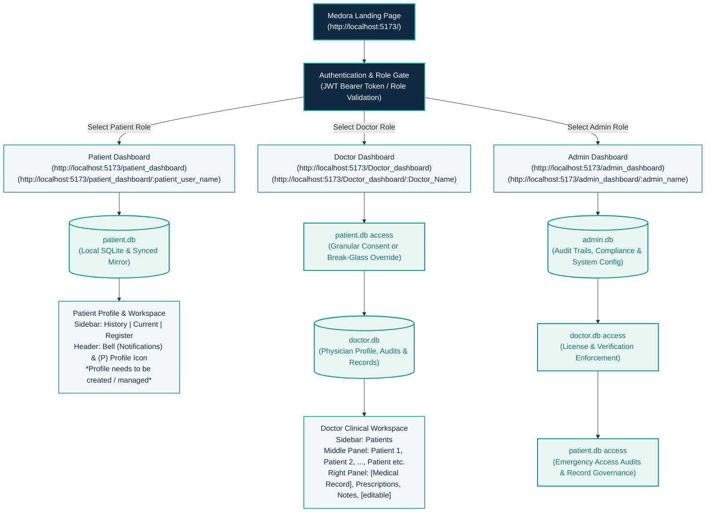

# Medora — Hand-Drawn Architecture Pipeline & System Blueprint

This document specifies the exact implementation of the hand-drawn architecture diagram for **Medora — AI-Powered Secure Emergency Medical History Access System**.

---

## 1. Hand-Drawn Diagram to System Architecture Mapping

---

## 2. Pipeline Components Breakdown

### A. Medora Landing Page (`/`)
- **Route**: `http://localhost:5173/`
- **Features**:
  - Live system status indicators (Triage latency < 0.4s, Break-glass 15m session timer, 256-bit encryption, Multi-database synchronization).
  - Interactive Visual Pipeline component showing the hand-drawn architecture live.
  - Three direct role gateways:
    - **Patient Portal**: -> `/patient_dashboard`
    - **Doctor Portal**: -> `/Doctor_dashboard`
    - **Admin Portal**: -> `/admin_dashboard`

---

### B. Authentication & Role Gate
- **Route**: Role-specific login pages with 1-click test credentials and live token generation.
- **Workflow**:
  1. User enters email/password.
  2. Backend `/api/v1/auth/login` validates credentials against salted SHA-256 / PBKDF2 hash.
  3. Returns JWT with claims: `{ sub: user_id, role: PATIENT | DOCTOR | ADMIN, user_name }`.
  4. Single Page App redirects to dynamic parameterized URL:
     - Patient: `/patient_dashboard/:patient_user_name` (e.g. `/patient_dashboard/sarah_jenkins`)
     - Doctor: `/Doctor_dashboard/:Doctor_Name` (e.g. `/Doctor_dashboard/Dr_Marcus_Vance`)
     - Admin: `/admin_dashboard/:admin_name` (e.g. `/admin_dashboard/Chief_Administrator_Elena`)

---

### C. Patient Pipeline & Dashboard
- **Database**: `patient.db`
  - Stores `patient_profiles`, `emergency_contacts`, `medical_conditions`, `medications`, `allergies`, `surgeries`, `consultation_requests`.
- **UI Layout (Direct from handwritten sketch)**:
  - **Header**:
    - Patient Name and ID: `Sarah Jenkins (PAT-2026-9812)`
    - jsPDF Download: Direct client-side PDF export of Medical Summary
    - `🔔` Bell Icon: Live notifications counter with popover drawer
    - `(P)` Profile Circle: Quick access to profile settings & active session indicator
  - **Left Sidebar**:
    1. `History`: Past surgeries, hospitalizations, emergency logs, and consultation history
    2. `Current`: Active prescriptions, ongoing treatments, and vital signs
    3. `Register`: Emergency card, dynamic emergency token, and emergency proxy contacts
    4. `Consultations`: Request & manage doctor consultation appointments
    5. `Doctor Access`: Review and revoke physician access consents
    6. `Profile & Directives`: Editable personal contact info, blood group, organ donor status, and DNR directive
  - **Editable Boundary**:
    - **Patient Editable**: Contact phone, address, emergency proxy notification preferences.
    - **Clinician Locked**: Clinical diagnoses, medications, and laboratory values (tamper-proof for emergency safety).

---

### D. Doctor Pipeline & Clinical Workspace
- **Databases**: `doctor.db` and authorized query access into `patient.db`
  - Stores `doctor_profiles`, `access_requests`, `break_glass_events`, `clinical_notes`, `prescriptions`.
- **UI Layout (Direct from handwritten sketch)**:
  - **Left Sidebar**:
    - Navigation: `Patients`, `Medical Records`, `Prescriptions`, `Consultations`, `Emergency Access (Break-Glass)`, `Notifications`.
  - **Middle Column (Patient Directory)**:
    - Lists: `Patient 1`, `Patient 2`, `Patient 3`, ...
    - Search input & status filtering: `All`, `Authorized`, `Emergency Override`, `Pending Consent`.
    - Real-time badge indicators: `Authorized`, `Break-Glass Active`, `Pending Consent`, `Locked`.
  - **Right Full-Width Clinical Workspace**:
    - Top bar: Patient Header with Emergency Flags (e.g., Anaphylaxis warnings, Blood type).
    - Tabs:
      - `[Medical Record]`: Multi-system medical records, chronic diagnoses, allergies, and surgical history.
      - `Prescription etc.`: Current medication regimens and active dosage schedules.
      - `Emergency Directives`: Organ donor status, resuscitation orders (DNR).
      - `Clinical Notes & Provenance`: Doctor encounter entries and verification stamps.
    - **`[editable]` Action Button**:
      - Opens modal allowing authorized doctors to author new diagnoses, prescriptions, and clinical visit notes.
      - Automatically logs authoring physician ID, timestamp, and updates both `patient.db` and `doctor.db`.

---

### E. Admin Pipeline & Governance
- **Databases**: `admin.db` with query access to `doctor.db` and audit oversight into `patient.db`
- **UI Layout**:
  - Physician verification and credentialing (Medical License validation).
  - Break-Glass Emergency audit logs (15-minute countdown tracking, reason verification, regulatory compliance).
  - System-wide audit logs with SHA-256 hash chaining for tamper prevention.

---

## 3. Local Multi-Database Architecture

| Database File | Role / Domain | Synchronized Tables |
| :--- | :--- | :--- |
| `patient.db` | Patient Portal | `patient_profiles`, `emergency_contacts`, `medical_conditions`, `medications`, `allergies`, `surgeries`, `consultation_requests` |
| `doctor.db` | Doctor Portal | `doctor_profiles`, `access_requests`, `break_glass_events`, `clinical_notes`, `prescriptions` |
| `admin.db` | Admin Portal | `audit_logs`, `system_metrics`, `user_accounts`, `break_glass_audits` |

All databases are automatically updated in real-time on every transaction via `backend/app/database/multidb.py`.
